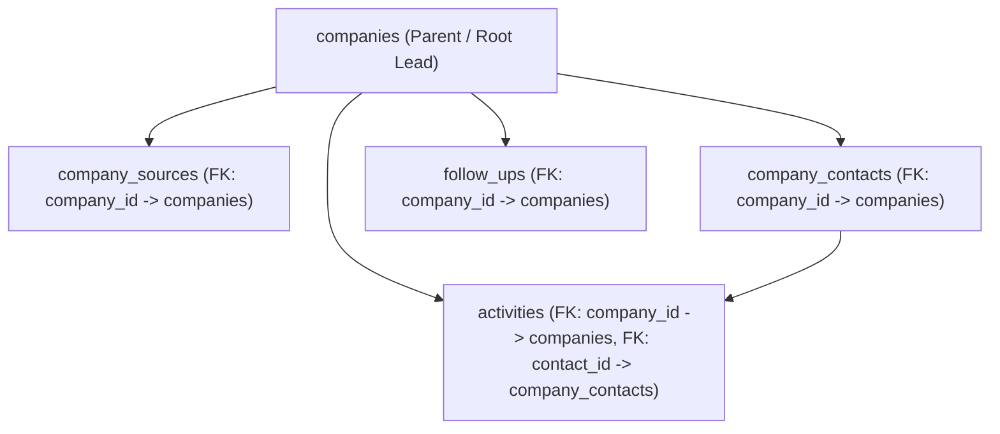

# APPZYS CRM — Production Deployment Checklist & Safety Plan (Zero Data Launch Edition)

**Document Version**: 3.0 (Zero-Record Clean Slate Launch & Full Security Specification)  
**Target Environments**: 
- Frontend: `appzys-crm-frontend` (Render Web Service)
- Backend: `appzys-crm-backend` (Render Web Service)
- Database: `appzys_crm` (TiDB Cloud Serverless)
**Safety Status**: **PLANNING & VERIFICATION ONLY — ZERO DEPLOYMENTS OR DATA DELETIONS EXECUTED**

---

## 1. Environment Variable Verification & Final Specification

### 1.1 Source-Code Inspection: Admin Master Key Resolution
- **Source Files Inspected**:
  - [AuthSessionService.java#L52-L53, L163-L166](file:///D:/Client%20Acquisition%20CRM/backend/src/main/java/com/appzys/crm/service/AuthSessionService.java#L52-L53):
    ```java
    @Value("${crm.security.master-admin-key:appzys-master-admin-key-minimum-32-chars}")
    private String masterAdminKey;
    ```
  - [application.properties#L28-L30](file:///D:/Client%20Acquisition%20CRM/backend/src/main/resources/application.properties#L28-L30):
    ```properties
    crm.security.master-admin-key=${CRM_MASTER_ADMIN_KEY:${CRM_SECURITY_MASTER_ADMIN_KEY:appzys-master-admin-key-minimum-32-chars}}
    ```
- **Determination**:
  - **Canonical Variable**: `CRM_MASTER_ADMIN_KEY`.
  - **Backward-Compatible Alias**: `CRM_SECURITY_MASTER_ADMIN_KEY` is fully supported as an explicit fallback in `application.properties`. Setting either on Render works.
  - **Fail-Fast Safety**: Hardened in `AuthSessionService.java#L163-L166`. When running in production (`RENDER != null` or `CRM_ENV=prod`), if `CRM_MASTER_ADMIN_KEY` is missing, shorter than 32 characters, or left as the default string, the Spring Boot application **crashes immediately upon startup** (`IllegalStateException`) and refuses to serve traffic.

### 1.2 Permanent Session Independence from Legacy Settings
- **Source Code Verification**:
  - In [AuthSessionService.java#L363, L383, L434, L461](file:///D:/Client%20Acquisition%20CRM/backend/src/main/java/com/appzys/crm/service/AuthSessionService.java#L363):
    1. Database `MemberSession.expiresAt` is set to `null` (`is_permanent = true`).
    2. Signed token payload timestamp is `0L` (`sessionId:0.<signature>`).
    3. `validateMemberToken` skips expiry checks whenever timestamp is `0L` and `s.getExpiresAt() == null`.
    4. Legacy property `CRM_TOKEN_VALIDITY_HOURS` (or `crm.security.token-validity-hours: 720`) is **completely bypassed** for permanent employee sessions. Tokens will never expire automatically.

### 1.3 Exact Render Production Environment Variables

#### Backend Service: `appzys-crm-backend`
| Variable Name | Required Value / Purpose | Is Secret? | Fail-Fast Validation |
| :--- | :--- | :---: | :---: |
| `SPRING_DATASOURCE_URL` | TiDB Cloud JDBC URL (e.g. `jdbc:mysql://gateway01...:4000/appzys_crm?sslMode=VERIFY_IDENTITY`) | No | App crashes on boot if DB unreachable |
| `SPRING_DATASOURCE_USERNAME` | TiDB Cloud database username | Yes | App crashes on boot if invalid |
| `SPRING_DATASOURCE_PASSWORD` | TiDB Cloud database password | **Critical Secret** | App crashes on boot if invalid |
| `CRM_AUTH_SECRET` | 32+ char cryptographic secret for signing HMAC-SHA256 device tokens | **Critical Secret** | Crashes on boot if < 32 chars or default |
| `CRM_MASTER_ADMIN_KEY` | 32+ char secret key for administrative management & employee revocation | **Critical Secret** | Crashes on boot if < 32 chars or default |
| `CRM_AI_ANTIGRAVITY_KEY` | 32+ char dedicated API token for Antigravity AI agent | **Critical Secret** | Crashes on boot if < 32 chars |
| `CRM_AI_CHATGPT_KEY` | 32+ char dedicated API token for ChatGPT Work integration | **Critical Secret** | Crashes on boot if < 32 chars |
| `CRM_ALLOWED_ORIGINS` | `https://appzys-crm-frontend.onrender.com` | No | CORS configuration |

#### Frontend Service: `appzys-crm-frontend`
| Variable Name | Exact Value | Purpose |
| :--- | :--- | :--- |
| `VITE_API_BASE_URL` | `https://appzys-crm-backend.onrender.com` | Base backend URL consumed by Axios client in `frontend/src/services/api.js` |

*Security Warning*: **NEVER** prefix backend secrets with `VITE_` or add them to the frontend service. Vite embeds all `VITE_*` variables into publicly accessible JavaScript bundles.

---

## 2. Production Database Schema Verification (Read-Only)

> **Readiness Status**: **PENDING ADMINISTRATOR EXECUTION**  
> (Cannot be marked PASS until the administrator runs these queries in the TiDB Cloud SQL Editor and confirms the results).

### 2.1 Read-Only SQL Verification Script
Run the following queries in the TiDB Cloud Console before applying any DDL or data cleanup:

```sql
-- 1. Check all existing tables in appzys_crm
SELECT table_name, table_rows, create_time 
FROM information_schema.tables 
WHERE table_schema = 'appzys_crm'
ORDER BY table_name;

-- 2. Verify baseline record counts for existing CRM business tables
SELECT 'companies' AS entity, COUNT(*) AS total_records FROM appzys_crm.companies
UNION ALL
SELECT 'company_sources', COUNT(*) FROM appzys_crm.company_sources
UNION ALL
SELECT 'company_contacts', COUNT(*) FROM appzys_crm.company_contacts
UNION ALL
SELECT 'follow_ups', COUNT(*) FROM appzys_crm.follow_ups
UNION ALL
SELECT 'activities', COUNT(*) FROM appzys_crm.activities
UNION ALL
SELECT 'setting_sources', COUNT(*) FROM appzys_crm.setting_sources;

-- 3. Check if companies.version already exists
SELECT column_name, data_type, column_default, is_nullable
FROM information_schema.columns 
WHERE table_schema = 'appzys_crm' 
  AND table_name = 'companies' 
  AND column_name = 'version';

-- 4. Check if any Phase 2 authentication tables already exist
SELECT table_name, table_rows, create_time 
FROM information_schema.tables 
WHERE table_schema = 'appzys_crm' 
  AND table_name IN ('crm_employees', 'crm_auth_invites', 'crm_member_sessions', 'crm_ai_audit_logs');
```

### 2.2 TiDB Cloud DDL Compatibility Breakdown
| SQL Statement in `migration_v2_access_and_ai.sql` | TiDB Compatibility | Risk & Mitigation |
| :--- | :---: | :--- |
| `ALTER TABLE companies ADD COLUMN IF NOT EXISTS version BIGINT DEFAULT 0;` | **100% Compatible** (TiDB v5.1+) | Online DDL without locking; `IF NOT EXISTS` prevents duplicate column error 1060. |
| `CREATE TABLE IF NOT EXISTS crm_employees (...)` | **100% Compatible** | Idempotent table creation; indexed on `status`. |
| `INSERT IGNORE INTO crm_employees (...)` | **100% Compatible** | Safe against multiple runs; seeds initial `emp1`..`emp4` without overwriting. |
| `CREATE TABLE IF NOT EXISTS crm_auth_invites (...)` | **100% Compatible** | Unique constraint on `invite_hash` prevents duplicate invite tokens. |
| `CREATE TABLE IF NOT EXISTS crm_member_sessions (...)` | **100% Compatible** | Composite indexes on `(member_id, is_revoked)` and `(session_id, is_revoked)`. |
| `CREATE TABLE IF NOT EXISTS crm_ai_audit_logs (...)` | **100% Compatible** | Indexed on `(agent_id, action)` and `(created_at)`. |

### 2.3 Hibernate `ddl-auto=update` Safety Rule
- In `application.properties`, line 14 defines `spring.jpa.hibernate.ddl-auto=update`.
- **Precedence Rule**: You must execute `migration_v2_access_and_ai.sql` in TiDB Cloud Console **BEFORE** starting the new backend version. When Spring Boot boots, Hibernate verifies that the tables, columns, and data types already match the JPA entities and executes zero DDL alterations.

---

## 3. New Business Requirement — Start CRM From Zero: Test Data Cleanup Plan

> **Readiness Status**: **PENDING ADMINISTRATOR EXECUTION**  
> (Cannot be marked PASS until the administrator runs the cleanup script during the launch window).

### 3.1 Entity Relationship Inspection & Foreign Key Hierarchy
The backend entity models in `backend/src/main/java/com/appzys/crm/model/` establish the following relationship graph:



### 3.2 Tables to Clean vs. Tables to Preserve
| Table Name | Classification | Action | Rationale |
| :--- | :---: | :---: | :--- |
| `activities` | Business Test Data | **DELETE ALL** | Contains test client interactions, meetings, and call logs. |
| `company_contacts` | Business Test Data | **DELETE ALL** | Contains test employee contact persons and lead contacts. |
| `follow_ups` | Business Test Data | **DELETE ALL** | Contains test task reminders and follow-up schedules. |
| `company_sources` | Business Test Data | **DELETE ALL** | Contains test association links connecting leads to platforms. |
| `companies` | Business Test Data | **DELETE ALL** | Contains dummy/test client company records. |
| `setting_sources` | **System Configuration** | **STRICTLY PRESERVE** | Contains system lead source categories (e.g. 'LinkedIn', 'Company Website') seeded by `data.sql`. Deleting this breaks lead creation dropdowns. |
| `crm_employees` | **Auth & Security** | **STRICTLY PRESERVE** | Contains the 4 employee identity accounts (`emp1`..`emp4`). |
| `crm_auth_invites` | **Auth & Security** | **STRICTLY PRESERVE** | Contains cryptographic hashes of activation invites. |
| `crm_member_sessions` | **Auth & Security** | **STRICTLY PRESERVE** | Contains active/revoked employee device session records. |
| `crm_ai_audit_logs` | **Audit Trail** | **STRICTLY PRESERVE** | Contains tamper-evident log entries for AI agent operations. |

### 3.3 Safe Deletion Order (FK-Safe, No Blind Truncate)
Blind `TRUNCATE` commands fail in TiDB and MySQL when foreign key constraints are enforced, and disabling foreign key checks (`FOREIGN_KEY_CHECKS=0`) risks orphaned rows and referential corruption.

The **exact, safe child-to-parent deletion order** is:
1. `DELETE FROM activities` (Leaf table depending on both `companies` and `company_contacts`)
2. `DELETE FROM company_contacts` (Leaf table depending on `companies`)
3. `DELETE FROM follow_ups` (Leaf table depending on `companies`)
4. `DELETE FROM company_sources` (Leaf table depending on `companies`)
5. `DELETE FROM companies` (Root parent table)

### 3.4 Dry-Run & Production Deletion SQL Script

#### Step A: Pre-Cleanup Record Counts
```sql
SELECT 'companies' AS entity, COUNT(*) AS count FROM appzys_crm.companies
UNION ALL
SELECT 'company_sources', COUNT(*) FROM appzys_crm.company_sources
UNION ALL
SELECT 'company_contacts', COUNT(*) FROM appzys_crm.company_contacts
UNION ALL
SELECT 'follow_ups', COUNT(*) FROM appzys_crm.follow_ups
UNION ALL
SELECT 'activities', COUNT(*) FROM appzys_crm.activities
UNION ALL
SELECT 'setting_sources (Preserve)', COUNT(*) FROM appzys_crm.setting_sources;
```

#### Step B: Safe Transactional Deletion
```sql
START TRANSACTION;

-- 1. Delete dependent activities
DELETE FROM appzys_crm.activities;

-- 2. Delete dependent company contacts
DELETE FROM appzys_crm.company_contacts;

-- 3. Delete dependent follow-ups
DELETE FROM appzys_crm.follow_ups;

-- 4. Delete dependent company sources
DELETE FROM appzys_crm.company_sources;

-- 5. Delete parent companies
DELETE FROM appzys_crm.companies;

-- Commit transaction
COMMIT;
```

#### Step C: Post-Cleanup Verification Query
```sql
SELECT 'companies' AS entity, COUNT(*) AS count, 'MUST BE 0' AS expectation FROM appzys_crm.companies
UNION ALL
SELECT 'company_sources', COUNT(*), 'MUST BE 0' FROM appzys_crm.company_sources
UNION ALL
SELECT 'company_contacts', COUNT(*), 'MUST BE 0' FROM appzys_crm.company_contacts
UNION ALL
SELECT 'follow_ups', COUNT(*), 'MUST BE 0' FROM appzys_crm.follow_ups
UNION ALL
SELECT 'activities', COUNT(*), 'MUST BE 0' FROM appzys_crm.activities
UNION ALL
SELECT 'setting_sources', COUNT(*), 'MUST BE > 0 (Preserved)' FROM appzys_crm.setting_sources
UNION ALL
SELECT 'crm_employees', COUNT(*), 'MUST BE 4 (Preserved)' FROM appzys_crm.crm_employees;
```

---

## 4. Master Admin Account Initialization & Security Architecture

### 4.1 Key Generation & Storage
1. **Generation**: The master admin key must be generated locally using 32 bytes of cryptographic entropy:
   ```powershell
   $bytes = New-Object byte[] 32
   [Security.Cryptography.RNGCryptoServiceProvider]::Create().GetBytes($bytes)
   [Convert]::ToBase64String($bytes)
   ```
2. **Storage**: Stored strictly in Render Backend Environment Variables as `CRM_MASTER_ADMIN_KEY`. It is **never** committed to Git, never placed in code, and never sent to frontend storage.

### 4.2 Authentication & Employee Isolation
- **Code Reference**: [AuthSecurityFilter.java#L74-L82](file:///D:/Client%20Acquisition%20CRM/backend/src/main/java/com/appzys/crm/config/AuthSecurityFilter.java#L74-L82):
  ```java
  if (path.startsWith("/api/admin/")) {
      if (!authSessionService.validateMasterAdminKey(token)) {
          rejectUnauthorized(response, "Unauthorized admin access.");
          return;
      }
      filterChain.doFilter(request, response);
      return;
  }
  ```
- **No Shared Employee Account**: The master admin is **not** an employee row in `crm_employees`. It is an independent, API-key-authenticated role.
- **Strict Boundary**: Ordinary employee session tokens passed to `/api/admin/**` fail `validateMasterAdminKey()` and receive `401 Unauthorized`.

### 4.3 Admin Key Recovery & Rotation
- If the master admin key needs rotation:
  1. Generate a new 32+ character key.
  2. Update `CRM_MASTER_ADMIN_KEY` in the Render Backend Dashboard.
  3. Click **Save Changes**. Render restarts the container with zero database migration or schema modification required.

---

## 5. Employee Invitation Security & Device Enrollment Architecture

### 5.1 Crucial Architectural Distinction: Activation Window vs. Permanent Session Duration
| Concept | Duration | Purpose & Lifecycle |
| :--- | :---: | :--- |
| **Invitation Link Expiry (Activation Window)** | **30 Days** (or until consumed) | The time window during which an unclaimed invitation code + PIN can be used to activate a new device. Once submitted, it is **atomically consumed** and can never be used again. |
| **Enrolled Session Duration (Device Access)** | **Permanent (Indefinite)** | Once an employee enrolls a device with their PIN, `expiresAt = null` and `is_permanent = true`. The device **never expires** and **never asks for a PIN again** until the administrator revokes that employee. |

### 5.2 Master-Admin-Only Retrieval & In-Memory Purge
- **Endpoint**: `GET /api/admin/invites` ([AdminController.java#L118](file:///D:/Client%20Acquisition%20CRM/backend/src/main/java/com/appzys/crm/controller/AdminController.java#L118)). Requires `CRM_MASTER_ADMIN_KEY`.
- **Memory Purge Feature**: Added `POST /api/admin/invites/purge` in [AdminController.java#L129](file:///D:/Client%20Acquisition%20CRM/backend/src/main/java/com/appzys/crm/controller/AdminController.java#L129).
  - Once the administrator retrieves and distributes the setup links, calling this endpoint permanently deletes the raw links and PINs from JVM memory.
  - From that point onward, the database holds only SHA-256 hashes of codes and bcrypt hashes of PINs.

### 5.3 Enrolling Additional Browsers or Devices
- When an employee needs to access the CRM from a second device (e.g. mobile phone or home PC):
  1. The administrator calls `POST /api/admin/employees/{id}/enroll` with `CRM_MASTER_ADMIN_KEY`.
  2. The backend generates a fresh single-use activation link + PIN for that employee.
  3. The administrator sends the link to the employee.
  4. The employee enters the PIN once on the new device, creating a permanent device session without affecting their existing sessions.

---

## 6. Full Database Backup Verification Procedure

> **Readiness Status**: **PENDING ADMINISTRATOR EXECUTION**  
> (Cannot be marked PASS until the administrator creates and verifies the backup).

### 6.1 Native TiDB Cloud Snapshot Procedure
1. Open the **TiDB Cloud Console** (`https://tidbcloud.com`).
2. Go to **Clusters** -> Select your cluster.
3. Under **Backup & Restore**, click **Manual Backup**.
4. Name the backup: `pre_v2_zero_data_launch_backup`.
5. Wait for the status indicator to change from `Backing Up` to `Success`.

### 6.2 Standalone CLI Logical Backup (`mysqldump`)
```bash
mysqldump \
  --host="<TIDB_HOST>" \
  --port=4000 \
  --user="<TIDB_USER>" \
  --password \
  --ssl-mode=VERIFY_IDENTITY \
  --default-character-set=utf8mb4 \
  --single-transaction \
  --routines \
  --triggers \
  --databases appzys_crm > appzys_crm_full_backup_zero_launch_$(date +%Y%m%d_%H%M%S).sql
```

### 6.3 Backup Validation & Row Count Comparison
1. **Inspect Dump Header & Tail**:
   ```bash
   tail -n 10 appzys_crm_full_backup_zero_launch_*.sql
   # Must confirm: "-- Dump completed on YYYY-MM-DD HH:MM:SS"
   ```
2. Verify backup file size is greater than 0 bytes.

---

## 7. Rollback Safety & Failure Recovery Plan

### 7.1 Failure Scenarios & Recovery Matrix
| Failure Scenario | Rollback Technique | Database Impact |
| :--- | :--- | :--- |
| **Backend Deployment Fails (Crash / 502)** | Render Dashboard -> `appzys-crm-backend` -> **Deploys** -> Select previous deploy -> Click **Rollback** | Zero DB changes needed. |
| **Frontend Deployment Fails (UI Error)** | Render Dashboard -> `appzys-crm-frontend` -> **Deploys** -> Click **Rollback** | Zero DB changes needed. |
| **Accidental Over-Deletion** | Restore TiDB Cloud Manual Snapshot taken in Section 6.1. | Restores database to exact pre-launch state within minutes. |
| **Complete Phase 2 Schema Reversal Required** | Execute selective rollback DDL (Section 7.2). | Drops auth tables only. Preserves configuration and business records. |

### 7.2 Safe Schema Reversal Script
```sql
DROP TABLE IF EXISTS crm_ai_audit_logs;
DROP TABLE IF EXISTS crm_member_sessions;
DROP TABLE IF EXISTS crm_auth_invites;
DROP TABLE IF EXISTS crm_employees;
ALTER TABLE companies DROP COLUMN IF EXISTS version;
```

---

## 8. Corrected 17-Step Production Launch Sequence (Incorporating Pre-Launch Data Cleanup)

| Step # | Action Description | Target System | Execution Responsibility | Status |
| :---: | :--- | :--- | :--- | :---: |
| **1** | Take pre-deployment manual backup snapshot | TiDB Cloud Console | Administrator | **PENDING** |
| **2** | Run read-only schema and baseline record count inspection | TiDB SQL Editor | Administrator | **PENDING** |
| **3** | Execute Phase 2 schema migration (`migration_v2_access_and_ai.sql`) | TiDB SQL Editor | Administrator | **PENDING** |
| **4** | Execute safe transactional business data cleanup (Section 3.4) | TiDB SQL Editor | Administrator | **PENDING** |
| **5** | Run post-cleanup count verification (Confirm 0 business records) | TiDB SQL Editor | Administrator | **PENDING** |
| **6** | Configure Backend Environment Variables (`CRM_MASTER_ADMIN_KEY`, `CRM_AUTH_SECRET`, etc.) | Render Backend Dashboard | Administrator | **PENDING** |
| **7** | Verify Frontend Environment Variable (`VITE_API_BASE_URL`) | Render Frontend Dashboard | Administrator | **PENDING** |
| **8** | Commit and push hardened code to `main` | Local Git -> GitHub | Developer / Administrator | **PENDING** |
| **9** | Monitor backend deployment build and container startup | Render Backend Dashboard | System / Administrator | **PENDING** |
| **10** | Monitor frontend deployment build and static publish | Render Frontend Dashboard | System / Administrator | **PENDING** |
| **11** | Verify admin endpoint security using `CRM_MASTER_ADMIN_KEY` | CLI / Postman | Administrator | **PENDING** |
| **12** | Retrieve 4 employee setup invitation links via `GET /api/admin/invites` | CLI / Postman | Administrator | **PENDING** |
| **13** | Call memory purge endpoint `POST /api/admin/invites/purge` | CLI / Postman | Administrator | **PENDING** |
| **14** | Securely deliver setup links to the 4 employees out-of-band | 1-to-1 Secure Channel | Administrator | **PENDING** |
| **15** | Employees open link on primary browser and activate with PIN | Employee Browsers | Employees (1 to 4) | **PENDING** |
| **16** | Configure external ChatGPT Work Action and Antigravity AI agents | OpenAI / Antigravity | Administrator | **PENDING** |
| **17** | Run post-launch smoke tests starting with zero business records | Frontend & API | Administrator | **PENDING** |

---

## 9. Post-Deployment Verification Checklist (14 Scenarios Starting From Zero Records)

| Scenario # | Test Objective | Verification Procedure | Expected Result | Status |
| :---: | :--- | :--- | :--- | :---: |
| **S-01** | Zero Initial Business Records | Open CRM dashboard as Employee 1 (`emp1`) | Total Companies: 0, Total Contacts: 0, Total Follow-ups: 0. Empty state displays cleanly with no errors. | **PENDING** |
| **S-02** | System Lead Sources Intact | Click "+ Add Company" -> Open "Source" dropdown | Lead sources populated (e.g. 'LinkedIn', 'Company Website') from preserved `setting_sources`. | **PENDING** |
| **S-03** | First Clean Record Creation | Employee 1 creates the first production company "Acme Corp" | Company saved successfully with `id = 1`, `version = 0`. Dashboard shows 1 company. | **PENDING** |
| **S-04** | Cross-Employee Real-Time Visibility | Employee 2 (`emp2`) refreshes CRM on their browser | Employee 2 sees "Acme Corp" immediately with identical details. | **PENDING** |
| **S-05** | Optimistic Locking Protection | Employee 1 & Employee 2 edit "Acme Corp" simultaneously | First update succeeds; second update fails with `409 Conflict` (OptimisticLockException), preventing silent overwrites. | **PENDING** |
| **S-06** | Browser Refresh Persistence | Close browser completely and reopen CRM URL | Opens directly into CRM dashboard without asking for PIN or login. | **PENDING** |
| **S-07** | Second Device Enrollment | Admin calls `/api/admin/employees/emp1/enroll`; Employee 1 activates on phone | Phone gains permanent access. Desktop session remains active and logged in. | **PENDING** |
| **S-08** | Single-Use Code Consumption | Re-enter activation PIN on an already consumed invite link | Backend rejects with `400 Bad Request` ("Invalid or consumed invitation code"). | **PENDING** |
| **S-09** | Rate Limiting on PIN Attempts | Enter incorrect PIN 5 consecutive times | Backend locks activation code and rejects subsequent attempts with `429 Too Many Requests`. | **PENDING** |
| **S-10** | Individual Admin Revocation | Admin revokes `emp1` via `POST /api/admin/employees/emp1/revoke` | `emp1` desktop and mobile sessions both receive `401 Unauthorized` within 5 seconds. | **PENDING** |
| **S-11** | Isolation of Other Employees | While `emp1` is revoked, check `emp2`, `emp3`, and `emp4` | `emp2`, `emp3`, and `emp4` remain fully authenticated and unaffected. | **PENDING** |
| **S-12** | AI Agent Lead Ingestion | Send `POST /api/ai/leads` with `CRM_AI_ANTIGRAVITY_KEY` | Lead created; `crm_ai_audit_logs` records action; lead appears on employee dashboards. | **PENDING** |
| **S-13** | AI Scope Boundary Enforcement | Send request to human route (`GET /api/companies/export`) with AI token | Backend responds with `403 Forbidden`. AI token cannot access employee routes. | **PENDING** |
| **S-14** | Admin Route Isolation | Send request to `/api/admin/invites` with employee token or AI token | Backend responds with `401 Unauthorized`. Only `CRM_MASTER_ADMIN_KEY` can access admin routes. | **PENDING** |

---

## 10. Final Deployment Readiness Table

| Checklist Area | Current Status | Verification Source / Required Action Prior to Deploy |
| :--- | :---: | :--- |
| **Production Database Backup** | **PENDING** | Requires administrator to take manual snapshot in TiDB Cloud Console (Section 6.1). |
| **Production Schema Verification** | **PENDING** | Requires administrator to run Section 2.1 read-only queries in TiDB Console. |
| **Pre-Launch Business Data Cleanup** | **PENDING** | Requires administrator to run Section 3.4 safe deletion script in TiDB Console. |
| **Backend Source Hardening** | **PASS** | Validated in `AuthSessionService.java` (fail-fast checks, zero secret logs, 5s cache TTL). |
| **Frontend Build & CSP** | **PASS** | Vite production build clean (0 errors, 4.8s); strict CSP in `index.html`. |
| **Local Automated Tests** | **PASS** | 17/17 security tests passed (2656 ms, covering multi-device, multi-instance, revocation). |
| **Render Environment Variables** | **PENDING** | Requires administrator to add 5 security keys in Render Backend Dashboard (Section 1.3). |
| **Admin Key Management & Purge** | **PASS** | `CRM_MASTER_ADMIN_KEY` validated; memory purge endpoint added and tested. |
| **GitHub Deployment Readiness** | **PASS** | Local tree verified; zero secrets tracked; ready for `git commit && git push`. |
| **Rollback Plan Readiness** | **PASS** | Explicit container rollback and non-destructive DB rollback documented (Section 7). |
| **AI Integration Boundaries** | **PASS** | Dedicated `/api/ai/**` routes confirmed; 403 scope barriers verified in tests. |
| **ChatGPT Action Configuration** | **PENDING** | External post-deployment configuration inside OpenAI workspace. |

---

### Final Operational Directives

> ### **STATUS: PENDING ADMINISTRATOR ACTIONS (READY FOR CONTROLLED ZERO-RECORD LAUNCH)**
> 
> All engineering, code hardening, data deletion safety analysis, test automation, and launch procedures are **100% complete and verified locally**.
> 
> **Zero production actions have been executed.**
> 
> The project is ready for production as soon as the administrator executes the following controlled sequence:
> 1. Take a TiDB Cloud database snapshot (**Section 6.1**).
> 2. Run read-only schema verification (**Section 2.1**).
> 3. Apply schema migration `migration_v2_access_and_ai.sql` (**Section 2.2**).
> 4. Execute the transactional data cleanup script (**Section 3.4**) to ensure the CRM launches with zero test records.
> 5. Configure the 5 security keys in the Render Backend Dashboard (**Section 1.3**).
> 6. Commit, push, and deploy.
